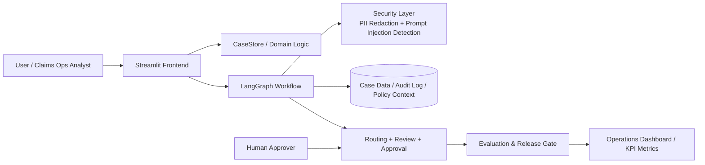

# Architecture Document

## Overview
This project implements a claims operations workflow designed for healthcare and insurance-style case handling. It provides a front-end dashboard for analysts and approvers, a workflow graph for orchestration, a case store for domain data, and evaluation logic for operational readiness.

## High-Level Architecture

## Major Components
### 1. Streamlit Interface
The front end exposes operational features such as:
- dashboard metrics
- case intake form
- queue management
- approval workflow
- case chat interface

### 2. Workflow Orchestration
The graph-based workflow organizes case progression through stages such as:
- intake
- document review
- state update
- human review
- final decision

### 3. Case Store
The centralized store manages domain data, summary generation, queue state, audit logs, and key metrics. It is the operational core of the application.

### 4. Security Controls
Safety is embedded into the system so that sensitive information is masked and suspicious inputs are flagged early.

### 5. Evaluation Layer
The evaluation layer translates operational results into a measurable readiness signal using thresholds and quality summaries.

## Why This Architecture Fits the Course
This design reflects forward-deployed engineering values:
- solves a real operational problem,
- keeps humans accountable,
- emphasizes safety and governance,
- demonstrates measurable workflow quality,
- supports iterative improvement with a clear product story.

## Conclusion
The system is intentionally built as a practical, auditable, human-in-the-loop claims workflow. It balances technical capability with governance, which is a strong foundation for a forward-deployed engineering proposal or portfolio submission.
