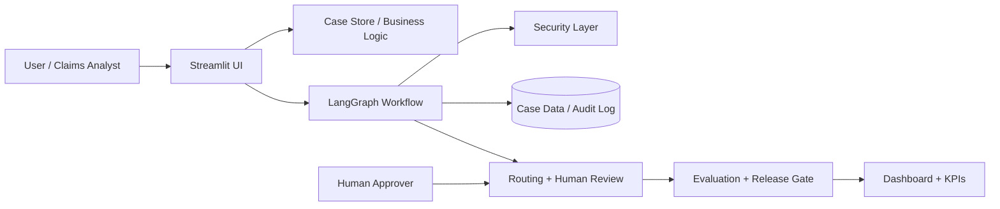

# Forward Deployed Engineering Course Submission Report

## Executive Summary
This project presents a healthcare claims operations assistant designed to improve triage, review, approval, and operational visibility for claims teams. It combines a human-in-the-loop workflow with safety checks, auditability, and metrics-driven governance to solve a realistic business problem in a trustworthy way.

## Problem Statement
Healthcare claims workflows are often fragmented and manual. Analysts must review large volumes of claims, reconcile policy details, identify missing information, and route complex or risky cases for approval. Without a structured workflow, these processes are slow, inconsistent, and difficult to monitor.

The system designed here addresses this by providing:
- case intake and registration,
- operational queue visibility,
- summary generation and case understanding,
- approval workflow with human accountability,
- safety protection around sensitive customer information,
- release quality and operational metrics.

## Business Need
The target user is an operations team handling claims across multiple cases, statuses, and approvers. The system is built to reduce handling friction, support consistency, and improve team visibility without eliminating human accountability.

## Architecture Overview
The application follows a layered architecture with distinct responsibilities:

1. Presentation layer
   - Streamlit user interface
   - dashboard and operational actions

2. Application layer
   - case store and business logic
   - workflow orchestration via LangGraph
   - routing and decision logic

3. Security layer
   - PII redaction
   - prompt injection detection
   - audit and traceability

4. Evaluation layer
   - quality checks
   - release readiness thresholds
   - KPI monitoring

## Key Design Decisions
### 1. Human-in-the-loop approval
Final decisions remain with a human approver. This avoids over-automation in a regulated domain and preserves accountability.

### 2. Safety-first design
The platform masks sensitive information and detects potential prompt injection patterns. This demonstrates operational responsibility and governance.

### 3. Auditability as a first-class requirement
Every major business action is recorded in a case trail. This helps operations, compliance, and incident response.

### 4. Evaluation-driven engineering
The system includes a measurable quality gate and release readiness logic so the product is not only functional but also testable and reviewable.

## Core Workflow
The workflow is organized around the following lifecycle:
1. Register case
2. Validate inputs and safety conditions
3. Review supporting data and case details
4. Generate summary and determine routing
5. Route to human review
6. Approve or reject or request follow-up
7. Log decisions and update dashboard

This approach supports both operational efficiency and trust.

## Data Model
The system models the healthcare workflow around a small but relevant domain model:
- ClaimCase
- Document
- Policy
- AuditEvent

These abstractions are sufficient to represent the real business flow while remaining lightweight enough for an applied engineering prototype.

## Security and Privacy Considerations
The system includes explicit controls to handle sensitive information responsibly:
- redaction of emails, phone numbers, SSNs, and similar identifiers,
- detection of prompt injection patterns,
- traceable audit logging,
- human approval before critical decisions.

This is especially important in a healthcare domain where trust and compliance matter.

## Operational Value
The platform improves the claims workflow by:
- reducing time spent on manual triage,
- improving consistency of decision support,
- increasing queue transparency,
- making case health visible to operations leadership,
- providing quality metrics and release gating.

## Evaluation and Validation
The solution uses a combination of:
- smoke tests for basic workflow integrity,
- evaluation-based thresholds for quality and release health,
- dashboard-based operational metrics.

This demonstrates engineering rigor and a product mindset rather than simply a demo.

## Why This Fits Forward Deployed Engineering
This project demonstrates critical FDE traits:
- grounded in a real operational problem,
- built for a user-facing workflow,
- includes safety, governance, and operational guardrails,
- produces measurable results,
- stays practical and production-minded without excessive complexity.

## Conclusion
This project shows how an AI-assisted workflow can enhance claims operations in a healthcare context while maintaining human oversight, safety, and measurable operational quality. It is a credible and deployable engineering artifact suitable for an FDE-style submission.

## Supporting Documentation
- [ARCHITECTURE.md](ARCHITECTURE.md)
- [docs/01_problem_statement.md](docs/01_problem_statement.md)
- [docs/02_requirements.md](docs/02_requirements.md)
- [docs/03_architecture_overview.md](docs/03_architecture_overview.md)
- [docs/04_data_model.md](docs/04_data_model.md)
- [docs/05_security_privacy.md](docs/05_security_privacy.md)
- [docs/06_workflow.md](docs/06_workflow.md)
- [docs/07_evaluation_plan.md](docs/07_evaluation_plan.md)
- [docs/08_runbook.md](docs/08_runbook.md)
- [docs/09_adrs.md](docs/09_adrs.md)
- [docs/10_executive_summary.md](docs/10_executive_summary.md)
